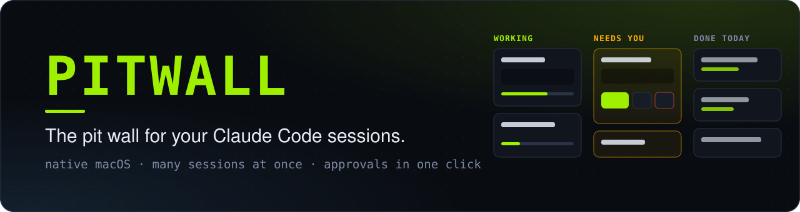
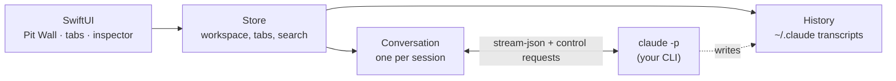

<p align="center">
  
</p>

<p align="center">
  <a href="https://github.com/shijisohail/pitwall/releases/latest"></a>
  <a href="https://github.com/shijisohail/pitwall/actions/workflows/ci.yml"></a>
  
  
  <a href="LICENSE"></a>
</p>

<p align="center">
  <b>A native macOS front end for <a href="https://docs.claude.com/en/docs/claude-code/overview">Claude Code</a>.</b><br>
  Run many sessions at once, approve their requests in one click, and watch every change land, all on a dark, terminal-flavoured board.
</p>

---

> ### 🎉 Pitwall v1.0.0 is out
> The first release is here. **[⬇️ Download Pitwall-1.0.0.dmg](https://github.com/shijisohail/pitwall/releases/download/v1.0.0/Pitwall-1.0.0.dmg)** · [Release notes](https://github.com/shijisohail/pitwall/releases/tag/v1.0.0) · [Changelog](CHANGELOG.md)
>
> The first builds are *ad-hoc signed, not notarized*, so macOS asks you to approve them once. See [Install](#install) (it takes ten seconds).

## Why Pitwall?

Claude Code is brilliant in a terminal, until you have four sessions going, one is waiting for permission to run a command, another finished ten minutes ago, and you can't remember which tab is which.

Pitwall is the **pit wall**: the place the engineers watch every car at once. It drives your own `claude` CLI, so your login, settings, skills, plugins, MCP servers and session history all carry over. Nothing is re-implemented and nothing leaves your Mac.

## Features

<table>
<tr>
<td width="50%" valign="top">

#### 🏁 Pit Wall board
Every session as a card in **Working**, **Needs you** and **Done today**, with a live feed of the last steps, to-do progress, cost, and **Allow / Always / Deny buttons right on the card**.

</td>
<td width="50%" valign="top">

#### 🗂 Tabs, many sessions at once
Browser-style tabs: drag to reorder, switch with <kbd>⌃Tab</kbd>. Closing a tab never stops a session; it keeps working in the background.

</td>
</tr>
<tr>
<td valign="top">

#### 📂 Open only what you choose
Pitwall shows and loads just the project folders you open, as many as you like. Closing one only hides it; your history is never deleted.

</td>
<td valign="top">

#### 🕘 Your real history
Reads Claude Code's own transcripts in `~/.claude`: terminal sessions appear here and Pitwall sessions appear in your terminal. A session running in a terminal **updates live**.

</td>
</tr>
<tr>
<td valign="top">

#### ✅ Native approvals
Tool permissions, Claude's multiple-choice questions and plan approval show up as proper cards, with "always allow" for the commands you trust.

</td>
<td valign="top">

#### 🔍 Inspector
A live **Changes** diff (with revert), the **Plan** and to-dos, **Context** usage, and every **Files** touched, beside the conversation.

</td>
</tr>
<tr>
<td valign="top">

#### ⌨️ Every command, native where it matters
<kbd>/</kbd> opens a menu of every command, skill, plugin command and MCP prompt you have. <kbd>@</kbd> mentions files, <kbd>!</kbd> runs a shell command, and you can paste or drop images.

</td>
<td valign="top">

#### 🔁 Switch anything, live
Model, effort and permission mode change mid-session. Fork a session, rename it, export it, or **hand it to Terminal** with <kbd>⇧⌘T</kbd>.

</td>
</tr>
</table>

Plus: a 5-hour and 7-day **usage meter**, ⌘K **search across every session and prompt**, **Settings** (⌘,), a quit-confirmation if sessions are still working, folders opened from the Dock, VoiceOver labels and Reduce Motion support.

### The board, at a glance

```text
┌─ PIT_WALL ─────────────────────────────────────────────────────────────────────────────┐
│  WORKING · 2              NEEDS YOU · 1                DONE TODAY · 3                  │
│  ┌──────────────────┐     ┌──────────────────────┐     ┌──────────────────┐            │
│  │ platform-core    │     │ platform-core        │     │ Migrate jobs     │            │
│  │ Refactor auth    │     │ Add rate limiting    │     │ 12 files +318 −140│           │
│  │ ✓ Read middleware│     │ Claude wants to run  │     └──────────────────┘            │
│  │ ✓ Edit +2 −1     │     │ $ npm install …      │     ┌──────────────────┐            │
│  │ › npm test …     │     │ [Allow][Always][Deny]│     │ Receipt PDF bug  │            │
│  │ ▓▓▓▓▓░░░ 3 of 5  │     └──────────────────────┘     └──────────────────┘            │
│  └──────────────────┘                                                                  │
└────────────────────────────────────────────────────────────────────────────────────────┘
```

*(A layout sketch.)*

## Install

**Requirements:** macOS 26 (Tahoe) or later, Apple silicon or Intel, and [Claude Code](https://docs.claude.com/en/docs/claude-code/setup) installed and signed in.

1. **[Download the latest `.dmg`](https://github.com/shijisohail/pitwall/releases/latest)** and open it.
2. Drag **Pitwall** onto **Applications**.
3. Open it. **The first time, macOS will say it can't verify the developer.** That's expected for an unsigned open-source build. Approve it once:
   - open **System Settings → Privacy & Security**, scroll down, and click **Open Anyway** next to Pitwall, **or**
   - run `xattr -dr com.apple.quarantine /Applications/Pitwall.app` in Terminal.
4. Click **Choose Folder…** and pick a project.

> Only approve builds you trust. Compare the `.dmg`'s SHA-256 with the `.sha256` file on the release (`shasum -a 256 -c Pitwall-1.0.0.dmg.sha256`), or build it yourself from source below. A copy you build on your own Mac never shows the warning.

## Quick start

1. **Open a project** (⌘O, or drop a folder on the window or the Dock icon).
2. **Start a session** (⌘N) and type a prompt. Press <kbd>/</kbd> for commands, <kbd>@</kbd> for files.
3. When Claude needs something, a card appears: **Allow**, **Always**, or **Deny** (with a note to redirect it).
4. Start a second session in another tab. Watch them both on the **Pit Wall** (⌘1).
5. Open the **Inspector** to see exactly what changed, and revert a file with one click.

## Keyboard shortcuts

| | |
|---|---|
| <kbd>⌘N</kbd> / <kbd>⌘T</kbd> | New session (tab) |
| <kbd>⌘W</kbd> / <kbd>⇧⌘W</kbd> | Close tab / close window |
| <kbd>⌃Tab</kbd> · <kbd>⌃⇧Tab</kbd> · <kbd>⇧⌘]</kbd> · <kbd>⇧⌘[</kbd> | Next / previous tab |
| <kbd>⌘1</kbd> / <kbd>⌘2</kbd> | Pit Wall / Sessions |
| <kbd>⌘K</kbd> | Search every session and prompt |
| <kbd>⌘O</kbd> | Open one or more project folders |
| <kbd>⇧⌘T</kbd> | Continue this session in Terminal |
| <kbd>⌘.</kbd> · <kbd>Esc</kbd> | Stop the current response |
| <kbd>⌘,</kbd> | Settings |
| <kbd>↑</kbd> in an empty prompt | Recall earlier prompts for this project |

## Commands

Anything the headless CLI can run (your skills, custom commands, `/compact`, `/context`, `/usage`, `/code-review`…) is passed straight through. Commands that normally only work inside Claude Code's terminal UI are implemented natively:

`/resume` · `/permissions` · `/hooks` · `/config` · `/memory` · `/status` · `/mcp` · `/add-dir` · `/plan` · `/rename` · `/export` · `/copy` · `/branch` · `/fork` · `/diff` · `/help` · `/skills` · `/login` · `/logout` · `/doctor`

## How it works



Pitwall launches `claude -p --input-format stream-json --output-format stream-json` for each session and speaks its control protocol, so permission prompts, questions and plan approvals arrive as structured requests it can answer. Session history is Claude Code's own on-disk transcripts: Pitwall keeps no database of conversations. Details: [Architecture](docs/ARCHITECTURE.md) and [protocol notes](docs/CLAUDE_CODE_PROTOCOL.md).

## Privacy and security

- **No telemetry, no analytics, no accounts, and no network connections of its own.**
- It reads and writes only local files (`~/.claude` and the folders you open) and talks to the `claude` process it starts; that CLI talks to Anthropic under its own terms.
- Transcripts can contain secrets, so they stay on your Mac. Help → **Copy Diagnostics** shares versions and counts only, never paths or content.
- Links in model output can only open as web or mail links, never `file:` or app URLs.
- Pitwall is intentionally **not sandboxed** (the sandbox would block launching your CLI and reading `~/.claude`). It uses the Hardened Runtime. **Full access** mode asks for confirmation.

More: [PRIVACY.md](PRIVACY.md) · [SECURITY.md](SECURITY.md).

## Build from source

You need Xcode 26 (or the matching Command Line Tools).

```sh
git clone https://github.com/shijisohail/pitwall.git && cd pitwall
Scripts/build.sh run          # universal, hardened-runtime app at build/Pitwall.app, then opens it
swift test                    # 74 tests (needs a working Xcode toolchain)
UNSIGNED=1 Scripts/release.sh # builds dist/Pitwall-<version>.dmg
```

`Scripts/build.sh` calls `swiftc` directly, so it also works on a bare Command Line Tools install where `swift build` is broken. See [CONTRIBUTING.md](CONTRIBUTING.md) and [docs/TESTING.md](docs/TESTING.md).

## Troubleshooting

- **"Claude Code wasn't found" banner:** install Claude Code, or choose its location in Settings (⌘,). Pitwall looks in `~/.local/bin`, Homebrew and your login shell's `PATH`.
- **"Not logged in" in a session:** click *Log in in Terminal* on the message, or run `claude auth login`.
- **macOS asks about Desktop / Documents / Downloads:** that is Claude Code, started by Pitwall, reaching a folder you opened. Allow it for the folders you want to work in.
- **"Live in a terminal" banner:** the session is also running in a terminal. Pitwall follows it read-only; use *Fork & Continue Here* to work on a copy.
- **Reporting a bug:** Help → **Copy Diagnostics**, and paste it into the issue.

## Known limitations

- No embedded terminal; Pitwall hands off to Terminal.app.
- `/rewind` checkpoints, a background-task panel and a light theme are not implemented yet.
- Subagent activity appears only as the parent's tool card.
- It relies on observed, only partly documented behaviour of Claude Code's headless protocol, so a CLI update can break something. Please [open an issue](https://github.com/shijisohail/pitwall/issues/new/choose) if it does.
- English only for now.

## FAQ

**Does Pitwall replace Claude Code?** No. It is a front end for it. Your CLI does all the work.

**Does it cost anything or need a separate login?** No. It uses the Claude Code installation and account you already have.

**Is it affiliated with Anthropic?** No. It is an independent community project. "Claude" and "Claude Code" are trademarks of Anthropic.

**Why isn't it sandboxed or in the Mac App Store?** Launching your CLI and reading `~/.claude` are impossible inside the App Sandbox.

## Contributing

Issues and pull requests are welcome. Start with [CONTRIBUTING.md](CONTRIBUTING.md) and the [Code of Conduct](CODE_OF_CONDUCT.md). Need help? See [SUPPORT.md](SUPPORT.md).

## License

[MIT](LICENSE). Pitwall is an independent project and is not endorsed by Anthropic.
